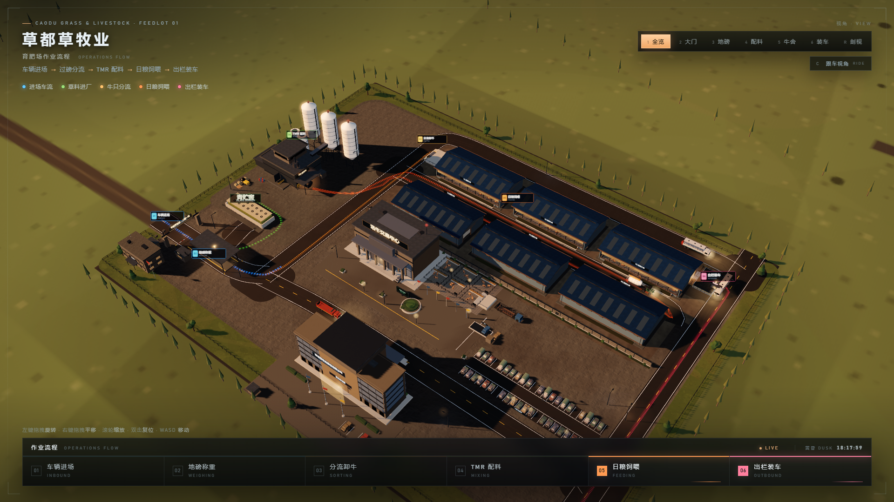
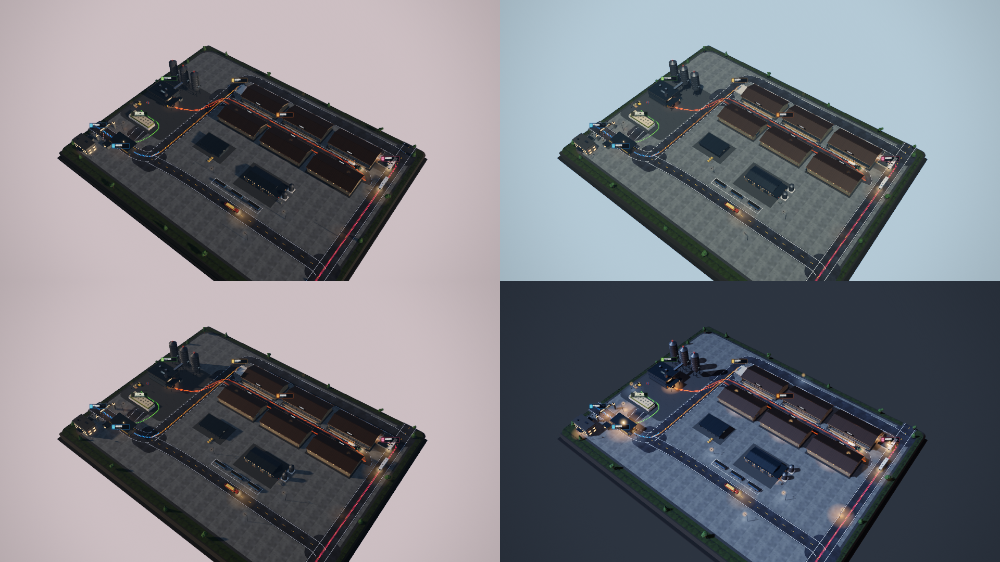

# 育肥场作业流程 · 3D 单园区

一个纯前端的三维园区作业流程演示：肉牛育肥场从**车辆进场 → 地磅称重 → 分流卸牛 / 草料进厂 → TMR 配料 → 日粮饲喂 → 出栏装车**的完整闭环，
用一条条流动光带把"牛走哪、草料走哪、日粮走哪、出栏车走哪"画在地面上，四台车按各自的路线循环跑。
园区一天从清晨走到深夜再回到清晨（约 3.5 分钟一轮），天光、阳光角度、场灯、雾和曝光都跟着时刻走。

**技术栈**：three.js `r187` + Vite 8（ESM、无框架、无运行时依赖），构建产物 775 kB / gzip 208 kB。

**在线预览**：<https://zhengjie1399677.github.io/feedlot-flow-3d/>



园区自己会走完一天（约 3.5 分钟一轮：清晨 → 白天 → 黄昏 → 夜间）：



## 跑起来

```bash
npm install
npm run dev       # http://127.0.0.1:5173
npm run build     # 产物在 dist/
npm run preview   # 本地预览构建产物
```

`dist/` 是纯静态产物，丢给任何静态服务器（nginx / Pages / `python -m http.server`）都能跑。
**不能双击 `index.html` 看**——ES module 和 `.glb` 都需要 HTTP，`file://` 下浏览器不给加载。

交互：

- 左键拖拽旋转 · 右键（或 Shift + 左键）拖拽平移 · 滚轮缩放 · 双击复位
- 键盘 `WASD` / 方向键平移（镜头中心会跟着走，可以随便挪到地块任意角落再放大看）
- 键盘 `1`–`6` 切换视角，右上角按钮同样可用（全览 / 大门 / 地磅 / 配料 / 牛舍 / 装车）
- 底部流程条的六个环节会随画面里车的当前位置自动点亮

## 剖视

**默认盖着屋顶**（完整建筑群）；按 `R` 或点右上角「剖视」，牛舍屋顶会淡成**半透明**（不是消失），既保住了体量，又能看见舍内的屋架、采食带、垫料休息区和牛。从鸟瞰角度看一栋"屋子"是看不清的，幽灵屋顶是同时保留俯视与内部信息的折中办法。

网址参数：`?cut=1` 直接进入剖视，`?roof=1` 强制实心屋顶。

- 右上角 **R 剖视** 按钮，或直接按 **R** 切换
- `?roof=1` 打开页面时保留屋顶（默认收起）

## URL 参数

| 参数 | 作用 |
| --- | --- |
| `?t=52` | 定格在第 52 秒：车辆按物理自行快进到那一刻（截图/对照用） |
| `?cam=gate` | 指定初始视角（`overview` / `gate` / `weigh` / `tmr` / `barn` / `dock`） |
| `?fx=0` | 关掉泛光后处理（低配机器或排查用） |
| `?ui=0` | 只留 3D 画面，隐藏所有界面（截图用） |
| `?sh=0` | 关掉阴影（排查用） |
| `?pan=80,40` | 把镜头中心移到地块坐标 (80, 40)，配合 `?cam=` 用来截局部 |
| `?hour=18.5` | 固定时刻（0–24）。不传就按 `?t=` 自动推进；截图对比昼夜很方便 |

## 场景里有什么

- **场院**：地面不是一块干净的水泥板——牛舍条带铺压实土，场院里叠了使用痕迹（脏迹斑块）和沿车辆路线铺的**轮胎印**，让地面有"被用过"的层次。
- **园区**：254×194 米地块，有厚度的地台（不是无限网格），**六栋育肥牛舍**（三栋朝南、三栋隔着日粮道朝北；屋脊百叶通风器 + 每跨采光带，南北两排屋面颜色分开，前脸卷帘半开露出料槽与颈夹，舍内有灯带和牛；门洞暖光、背面高位通风格栅）、卸牛台、地磅与磅房、大门门卫、综合楼、TMR 配料中心 + 三只原料筒仓 + 青贮窖（覆膜 + 压胎）、出栏装车台、路灯、树。
- **生产区与交易区**：一道 2.4 米高的围墙把牛舍区隔开，留一处车行大门（挂着"生产区 · 谢绝参观"）和一处人行小门；围墙南侧是**活牛交易中心**——玻璃幕墙的交易大厅（行情屏写着当日活牛价与成交头数）、六格待售栏（料槽、水槽、栏间过道灯）、装牛台和一辆停着的活牛车、交易地磅、四个彩色雨棚摊位、彩旗和中央花池；交易中心东侧是**员工停车场**（两排车位、四十来台车、四盏车位灯），大厅门口还有几台临停；南侧临路是三层**员工办公楼**（中部塔楼 + 通高中庭 + 柱廊，双面开窗，夜里整栋亮着）。
- **牛**：66 头（交易栏 18 + 六栋牛舍舍内各 8），西门塔尔那样的黄褐白花。
  - `GLTFLoader` 载入 `public/models/cow_polyfork.glb`，`SkeletonUtils.clone` 克隆 66 份，每头一个 `AnimationMixer`：大部分站着播 Idle（呼吸、甩尾、低头），一小部分**真的在走**——牛舍里靠栏前那几头沿着采食通道来回踱步，栏圈里每栏有一头绕圈，走到头会停下、播 Idle 转身，再继续；走的时候播 Walk，两个动作之间用 0.35s 交叉淡入淡出。
  - 配色统一按顶点亮度把黑白花重映射成西门塔尔的黄褐 + 白（`recolor()`），所以换任何花色贴图的模型都能落到同一套语汇上。
- **车**：活牛运输车（栅栏车厢）、草料自卸车（草捆 + 篷布）、TMR 日粮车（拖拉机 + 卧式搅拌罐）、出栏平板车。车按弧长路线跑，到站点会停留（过磅 3s、卸青贮 9s、卸牛 10s、投料 6s×6 站、装车 10s），停靠时地面上会亮起作业光斑并浮出作业标签。
- **流向**：五组加法混合的流光带（进场 / 草料 / 牛只 / 日粮 / 出栏），用 `uTime` 驱动脉冲前进，配合路面黄色中线一起指出方向。
- **昼夜**：`src/daycycle.js` 把一天拆成深夜 / 晨昏 / 白天三套配色做连续插值——天空穹顶的顶点色、太阳与月亮的方位和光色、半球光、雾的颜色与浓度、曝光、场内灯具与地面光斑的亮度全部同步，太阳落下去时场灯和窗户一点点亮起来。
- **氛围**：ACES + 半分辨率自写泛光、PMREM 环境光、月光主光 + 暖色补光 + 场灯点光、地面暖光池、雾、星空。
- **车辆怎么跑**：不再按时间表硬贴位置，而是逐帧积分——进站前按 `v²=2as` 匀减速、停靠后线性加速、前方 34m 内有同向车就按车距降速（停靠中的车也算障碍），所以会出现真实的排队和让行；减速/停住时尾灯变亮，转弯前 8m 打对应一侧的转向灯。

## 目录结构

```
index.html            入口，只挂一个 <script type="module" src="/src/main.js">
vite.config.js        base:'./'（Pages 子路径可用）、dist 输出、glb 资产
public/models/        cow_polyfork.glb + cars/（Kenney 车模，原样拷进 dist/models/）
public/hdri/          四张 256×128 全景图（晨 / 午 / 黄昏 / 夜），按时刻切换环境光
public/tex/           四套 PBR 贴图（color / normal / rough / ao），ambientCG 512²
css/style.css         深色工业风界面（标题 / 图例 / 视角 / 流程条 / 载入遮罩）
src/main.js           装配、主循环、自适应、URL 参数
src/fl.js             全局命名空间对象（各模块往上面挂 API）
src/utils.js          程序化贴图、倒角盒、几何合并 Kit、文字贴图、曲线 Path、补间
src/layout.js         唯一的数据源：地块、路网、车辆路线、流向带、六个阶段、镜头预设
src/world.js          地面 / 道路 / 围栏 / 灯杆 / 树 / 标签 / 灯光 / 地面光池
src/terrain.js        场界之外的地形：条田贴图、农田防护林、村庄、进场道路延伸
src/cows.js           牛群：GLTF + 骨骼动画
src/cars.js           停车场的车：GLB 载入 + 按车位摆放
src/buildings.js      牛舍、地磅、大门、办公室、TMR 车间与筒仓、卸牛台、装车台、交易中心、员工楼、停车场、围墙
src/vehicles.js       车辆造型 + 运动物理（加减速 / 跟车让行 / 刹车灯 / 转向灯）
src/effects.js        环境贴图（HDRI 分时段）、天空穹顶与星空、相机轨道、泛光管线
src/daycycle.js       昼夜循环：按时刻插值天光、日月、场灯、雾、曝光
src/ui.js             图例 / 视角按钮 / 流程条 / 时钟
tools/shots.sh        无头 Chrome 出 3 机位 × 3 时刻的对照图组
tools/sheet.py        把对照图拼成一张联络表
tools/diff.py         两组对照图做像素差，标出可见差异
```

想要改路线、加站点、换颜色，基本只需要动 `src/layout.js`：路网 `roads`、车辆 `routes`、光带 `flow`、流程 `stages`、镜头 `cameras` 都在一个文件里。

## 性能与兼容

- 需要 WebGL2；three.js r187（ESM），addons 只用了 `GLTFLoader` 与 `SkeletonUtils`。
- 几何按材质合并（`U.Kit`），整场 draw call 压在一百以内；阴影贴图 2048，只留一盏主光投影。
- 场景尺寸和像素比都做了限制（`devicePixelRatio` 最高 1.6），1080p 下目标 60fps。
- 构建产物的 JS 约 790 kB（gzip 212 kB），另有 `public/` 下按需加载的模型与贴图约 5 MB（牛 1.5 MB、车 1.35 MB、贴图 760 kB、全景图 512 kB）；`vite build` 会提示 chunk > 500 kB，属于预期——几何与贴图全是代码生成的，没有可拆的异步边界。

## 改完怎么验：对照图组

美术改动最怕"感觉好像变好了"。这个仓库的做法是**固定机位 × 固定时刻**出图，用像素差说话：

```bash
npm run dev &                                        # 或任何静态服务器
SHOT_BASE=http://127.0.0.1:5173/index.html \
  bash tools/shots.sh tools/after 960 540            # 3 机位 × 3 时刻 = 9 张 + 联络表
python tools/diff.py tools/before tools/after         # 平均差 / 可见差异像素占比
```

`diff.py` 会把「左旧 | 右新 | 差异×6」三联图存下来，一眼就能定位是哪块变了。

两个坑：

- 每次都开一个全新的 Chrome profile（脚本里 `--user-data-dir` 每次不同），复用 profile 会缓存模块，改了代码看不到变化；
- 用**真实 GPU** 后端截图（脚本里没有 `--use-angle=swiftshader`）。SwiftShader 会把着色器里的 NaN 画成透明，真实显卡上却是黑块——之前灯柱体积光的 `pow()` 底数取了负值，就是这么漏过去的。

## 部署

**GitHub Pages**：推 `main` 就自动构建发布（`.github/workflows/deploy.yml`：`npm ci` → `npm run build` → 上传 `dist/`）。
仓库 Settings → Pages → Source 选 **GitHub Actions**。

**自己托管**：`npm run build` 之后把 `dist/` 当站点根目录，**不需要反向代理**——

```nginx
server {
    listen 80;
    server_name feedlot.example.com;
    root /var/www/feedlot-flow-3d/dist;
    index index.html;

    location / { try_files $uri $uri/ =404; }

    location ~* \.(js|css|png|glb|woff2)$ {
        expires 7d;
        add_header Cache-Control "public, immutable";
    }
}
```

`dist/index.html` 引用的是相对路径（`./assets/...`），放在子目录下也照样能跑。

## 许可

MIT。拿去随便用，商用、改、闭源分发都行，只要保留 LICENSE 里的版权声明即可（three.js 本体是 MIT，其版权归 three.js 作者）。

## 素材与致谢

- 牛模型：[polyfork.dev · Cow base](https://polyfork.dev/asset/cow-base)（CC0），绑定姿势的顶点 / 法线 / 顶点色 / 索引连带 Idle / Walk 两段骨骼动画都在 `public/models/cow_polyfork.glb` 里。
- 其余建筑、车辆、贴图全部程序化生成，不依赖外部资源。
