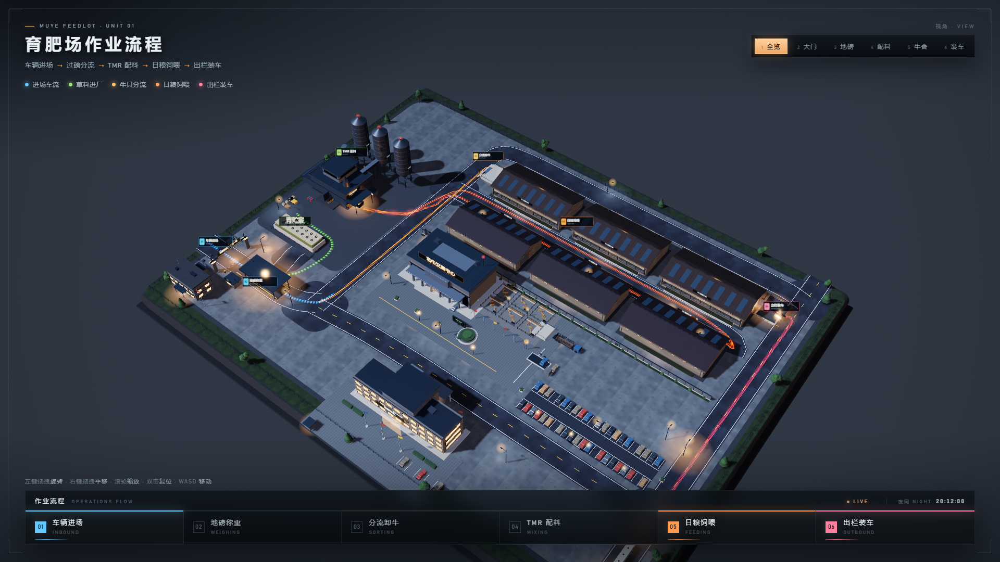

# 育肥场作业流程 · 3D 单园区

一个纯前端的三维园区作业流程演示：肉牛育肥场从**车辆进场 → 地磅称重 → 分流卸牛 / 草料进厂 → TMR 配料 → 日粮饲喂 → 出栏装车**的完整闭环，
用一条条流动光带把"牛走哪、草料走哪、日粮走哪、出栏车走哪"画在地面上，四台车按各自的路线循环跑。

**在线预览**：<https://zhengjie1399677.github.io/feedlot-flow-3d/>



## 打开方式

直接**双击 `index.html`** 即可（three.js 放在 `vendor/` 里本地引用，不走网络，`file://` 也能跑）。

也可以起个静态服务：

```bash
python -m http.server 8080
# http://localhost:8080
```

交互：

- 左键拖拽旋转 · 右键（或 Shift + 左键）拖拽平移 · 滚轮缩放 · 双击复位
- 键盘 `WASD` / 方向键平移（镜头中心会跟着走，可以随便挪到地块任意角落再放大看）
- 键盘 `1`–`6` 切换视角，右上角按钮同样可用（全览 / 大门 / 地磅 / 配料 / 牛舍 / 装车）
- 底部流程条的六个环节会随画面里车的当前位置自动点亮

## URL 参数

| 参数 | 作用 |
| --- | --- |
| `?t=52` | 定格在第 52 秒：车辆按物理自行快进到那一刻（截图/对照用） |
| `?cam=gate` | 指定初始视角（`overview` / `gate` / `weigh` / `tmr` / `barn` / `dock`） |
| `?fx=0` | 关掉泛光后处理（低配机器或排查用） |
| `?ui=0` | 只留 3D 画面，隐藏所有界面 |
| `?sh=0` | 关掉阴影（排查用） |
| `?pan=80,40` | 把镜头中心移到地块坐标 (80, 40)，配合 `?cam=` 用来截局部 |

## 场景里有什么

- **园区**：254×194 米地块，有厚度的地台（不是无限网格），三栋育肥牛舍（料槽、颈夹、饮水槽、卷帘、百叶门洞暖光）、卸牛台、地磅与磅房、大门门卫、综合楼、TMR 配料中心 + 三只原料筒仓 + 青贮窖、出栏装车台、机修车库、干草棚、挂车停车场、路灯、树。
- **车**：活牛运输车（栅栏车厢）、草料自卸车（草捆 + 篷布）、TMR 日粮车（拖拉机 + 卧式搅拌罐）、出栏平板车。车按弧长路线跑，到站点会停留（过磅 4s、卸牛 12s、投料 8s、装车 14s），停靠时地面上会亮起作业光斑并浮出作业标签。
- **流向**：五组加法混合的流光带（进场 / 草料 / 牛只 / 日粮 / 出栏），用 `uTime` 驱动脉冲前进，配合路面黄色中线一起指出方向。
- **氛围**：ACES + 半分辨率自写泛光、PMREM 环境光、月光主光 + 暖色补光 + 场灯点光、地面暖光池、雾。
- **车辆怎么跑**：不再按时间表硬贴位置，而是逐帧积分——进站前按 `v²=2as` 匀减速、停靠后线性加速、前方 34m 内有同向车就按车距降速（停靠中的车也算障碍），所以会出现真实的排队和让行；减速/停住时尾灯变亮，转弯前 8m 打对应一侧的转向灯。

## 目录结构

```
index.html          入口，按顺序挂脚本
css/style.css       深色工业风界面（标题 / 图例 / 视角 / 流程条 / 载入遮罩）
js/utils.js         程序化贴图、倒角盒、几何合并 Kit、文字贴图、曲线 Path、补间
js/layout.js        唯一的数据源：地块、路网、车辆路线、流向带、六个阶段、镜头预设
js/world.js         地面 / 道路 / 围栏 / 灯杆 / 树 / 标签 / 灯光 / 地面光池
js/buildings.js     牛舍、地磅、大门、办公室、TMR 车间与筒仓、卸牛台、装车台、车库、干草棚
js/vehicles.js      车辆造型 + 运动物理（加减速 / 跟车让行 / 刹车灯 / 转向灯）
js/effects.js       环境贴图、天空与星空、相机轨道、泛光管线
js/ui.js            图例 / 视角按钮 / 流程条 / 时钟
js/main.js          装配、主循环、自适应、URL 参数
tools/shot.sh       无头 Chrome 截图脚本（改完代码出对比图用）
```

想要改路线、加站点、换颜色，基本只需要动 `js/layout.js`：路网 `roads`、车辆 `routes`、光带 `flow`、流程 `stages`、镜头 `cameras` 都在一个文件里。

## 性能与兼容

- 需要 WebGL2；后端是 r159 UMD 版 three.js，不用任何 addons。
- 几何按材质合并（`U.Kit`），整场 draw call 压在一百以内；阴影贴图 2048，只留一盏主光投影。
- 场景尺寸和像素比都做了限制（`devicePixelRatio` 最高 1.6），1080p 下目标 60fps。

## 截图

```bash
bash tools/shot.sh 52 1920 1080 tools/shot.png
```

两个坑：

- 每次都开一个全新的 Chrome profile，复用 profile 会缓存 `file://` 的 JS，改了代码看不到变化；
- 用**真实 GPU** 后端截图（脚本里没有 `--use-angle=swiftshader`）。SwiftShader 会把着色器里的 NaN 画成透明，真实显卡上却是黑块——之前灯柱体积光的 `pow()` 底数取了负值，就是这么漏过去的。
