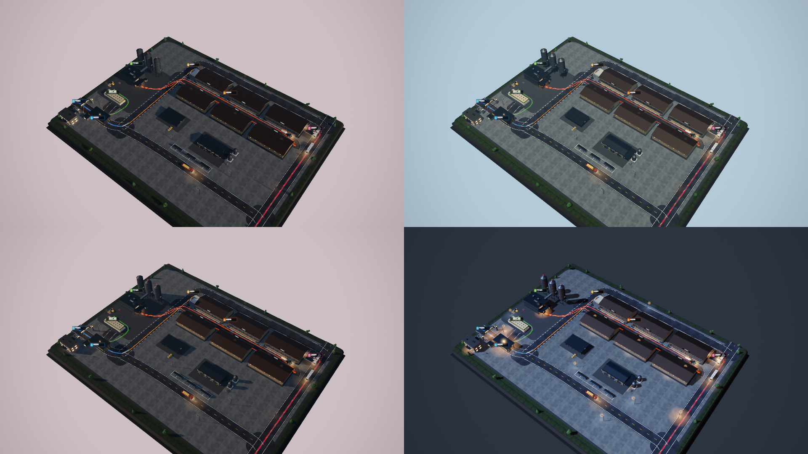

# 育肥场作业流程 · 3D 单园区

一个纯前端的三维园区作业流程演示：肉牛育肥场从**车辆进场 → 地磅称重 → 分流卸牛 / 草料进厂 → TMR 配料 → 日粮饲喂 → 出栏装车**的完整闭环，
用一条条流动光带把"牛走哪、草料走哪、日粮走哪、出栏车走哪"画在地面上，四台车按各自的路线循环跑。
园区一天从清晨走到深夜再回到清晨（约 3.5 分钟一轮），天光、阳光角度、场灯、雾和曝光都跟着时刻走。

**在线预览**：<https://zhengjie1399677.github.io/feedlot-flow-3d/>


园区自己会走完一天（约 3.5 分钟一轮：清晨 → 白天 → 黄昏 → 夜间）：



## 打开方式

直接**双击 `index.html`** 即可（three.js 放在 `vendor/` 里本地引用，不走网络，`file://` 也能跑）。

也可以起个静态服务：

```bash
python -m http.server 8080
# http://localhost:8080
```

交互：

- 左键拖拽旋转 · 右键（或 Shift + 左键）拖拽平移 · 滚轮缩放 · 双击复位
- 键盘 `WASD` / 方向键平移（镜头中心会跟着走，可以随便挪到地块任意角落再放大看）
- 键盘 `1`–`6` 切换视角，右上角按钮同样可用（全览 / 大门 / 地磅 / 配料 / 牛舍 / 装车）
- 底部流程条的六个环节会随画面里车的当前位置自动点亮

## 剖视

**默认盖着屋顶**（完整建筑群）；按 `R` 或点右上角「剖视」，牛舍屋顶会淡成**半透明**（不是消失），既保住了体量，又能看见舍内的屋架、采食带、垫料休息区和牛。从鸟瞰角度看一栋"屋子"是看不清的，幽灵屋顶是同时保留俯视与内部信息的折中办法。

网址参数：`?cut=1` 直接进入剖视，`?roof=1` 强制实心屋顶。

- 右上角 **R 剖视** 按钮，或直接按 **R** 切换
- `?roof=1` 打开页面时保留屋顶（默认收起）

## URL 参数

| 参数 | 作用 |
| --- | --- |
| `?t=52` | 定格在第 52 秒：车辆按物理自行快进到那一刻（截图/对照用） |
| `?cam=gate` | 指定初始视角（`overview` / `gate` / `weigh` / `tmr` / `barn` / `dock`） |
| `?fx=0` | 关掉泛光后处理（低配机器或排查用） |
| `?ui=0` | 只留 3D 画面，隐藏所有界面 |
| `?sh=0` | 关掉阴影（排查用） |
| `?pan=80,40` | 把镜头中心移到地块坐标 (80, 40)，配合 `?cam=` 用来截局部 |
| `?hour=18.5` | 固定时刻（0–24）。不传就按 `?t=` 自动推进；截图对比昼夜很方便 |

## 场景里有什么

- **场院**：地面不是一块干净的水泥板——牛舍条带铺压实土，场院里叠了使用痕迹（脏迹斑块）和沿车辆路线铺的**轮胎印**，让地面有"被用过"的层次。
- **园区**：254×194 米地块，有厚度的地台（不是无限网格），**六栋育肥牛舍**（三栋朝南、三栋隔着日粮道朝北；屋脊百叶通风器 + 每跨采光带，南北两排屋面颜色分开，前脸卷帘半开露出料槽与颈夹，舍内有灯带和牛；门洞暖光、背面高位通风格栅）、卸牛台、地磅与磅房、大门门卫、综合楼、TMR 配料中心 + 三只原料筒仓 + 青贮窖（覆膜 + 压胎）、出栏装车台、路灯、树。
- **生产区与交易区**：一道 2.4 米高的围墙把牛舍区隔开，留一处车行大门（挂着"生产区 · 谢绝参观"）和一处人行小门；围墙南侧是**活牛交易中心**——玻璃幕墙的交易大厅（行情屏写着当日活牛价与成交头数）、六格待售栏（料槽、水槽、栏间过道灯）、装牛台和一辆停着的活牛车、交易地磅、四个彩色雨棚摊位、彩旗和中央花池；交易中心东侧是**员工停车场**（两排车位、四十来台车、四盏车位灯），大厅门口还有几台临停；南侧临路是三层**员工办公楼**（中部塔楼 + 通高中庭 + 柱廊，双面开窗，夜里整栋亮着）。
- **牛**：66 头（交易栏 18 + 六栋牛舍舍内各 8），西门塔尔那样的黄褐白花。
  - 走 `http://` 时：GLTFLoader 载入 `vendor/models/cow_polyfork.glb`，SkeletonUtils 克隆 66 份，每头一个 `AnimationMixer`：大部分站着播 Idle（呼吸、甩尾、低头），一小部分**真的在走**——牛舍里靠栏前那几头沿着采食通道来回踱步，栏圈里每栏有一头绕圈，走到头会停下、播 Idle 转身，再继续；走的时候播 Walk，两个动作之间用 0.35s 交叉淡入淡出。
  - 双击 `file://` 打开时：浏览器不让跑 ES module / fetch 本地文件，自动退回 `js/cow-asset.js` 里预先烘好的 6 帧顶点，用 6 个 InstancedMesh 轮换，同样会动，只是没有骨骼插值那么顺。
  - 两条路共用一套配色映射：按顶点亮度把黑白花重映射成西门塔尔的黄褐 + 白（`recolor()`）。
- **车**：活牛运输车（栅栏车厢）、草料自卸车（草捆 + 篷布）、TMR 日粮车（拖拉机 + 卧式搅拌罐）、出栏平板车。车按弧长路线跑，到站点会停留（过磅 3s、卸青贮 9s、卸牛 10s、投料 6s×6 站、装车 10s），停靠时地面上会亮起作业光斑并浮出作业标签。
- **流向**：五组加法混合的流光带（进场 / 草料 / 牛只 / 日粮 / 出栏），用 `uTime` 驱动脉冲前进，配合路面黄色中线一起指出方向。
- **昼夜**：`js/daycycle.js` 把一天拆成深夜 / 晨昏 / 白天三套配色做连续插值——天空穹顶的顶点色、太阳与月亮的方位和光色、半球光、雾的颜色与浓度、曝光、场内灯具与地面光斑的亮度全部同步，太阳落下去时场灯和窗户一点点亮起来。
- **氛围**：ACES + 半分辨率自写泛光、PMREM 环境光、月光主光 + 暖色补光 + 场灯点光、地面暖光池、雾、星空。
- **车辆怎么跑**：不再按时间表硬贴位置，而是逐帧积分——进站前按 `v²=2as` 匀减速、停靠后线性加速、前方 34m 内有同向车就按车距降速（停靠中的车也算障碍），所以会出现真实的排队和让行；减速/停住时尾灯变亮，转弯前 8m 打对应一侧的转向灯。

## 目录结构

```
index.html          入口，按顺序挂脚本
css/style.css       深色工业风界面（标题 / 图例 / 视角 / 流程条 / 载入遮罩）
js/utils.js         程序化贴图、倒角盒、几何合并 Kit、文字贴图、曲线 Path、补间
js/layout.js        唯一的数据源：地块、路网、车辆路线、流向带、六个阶段、镜头预设
js/world.js         地面 / 道路 / 围栏 / 灯杆 / 树 / 标签 / 灯光 / 地面光池
js/cows.js          牛群：有 GLTFLoader 时走骨骼动画，否则退回预烘 6 帧
js/gltf-boot.js     ES module：装载 GLTFLoader + SkeletonUtils（只在 http 下生效）
server.js           零依赖静态服务器（本地开发用，node server.js）
js/buildings.js     牛舍、地磅、大门、办公室、TMR 车间与筒仓、卸牛台、装车台、交易中心、员工楼、停车场、围墙
js/vehicles.js      车辆造型 + 运动物理（加减速 / 跟车让行 / 刹车灯 / 转向灯）
js/effects.js       环境贴图、天空穹顶与星空、相机轨道、泛光管线
js/daycycle.js      昼夜循环：按时刻插值天光、日月、场灯、雾、曝光
js/ui.js            图例 / 视角按钮 / 流程条 / 时钟
js/main.js          装配、主循环、自适应、URL 参数
tools/shot.sh       无头 Chrome 截图脚本（改完代码出对比图用）
```

想要改路线、加站点、换颜色，基本只需要动 `js/layout.js`：路网 `roads`、车辆 `routes`、光带 `flow`、流程 `stages`、镜头 `cameras` 都在一个文件里。

## 性能与兼容

- 需要 WebGL2；后端是 r159 UMD 版 three.js，不用任何 addons。
- 几何按材质合并（`U.Kit`），整场 draw call 压在一百以内；阴影贴图 2048，只留一盏主光投影。
- 场景尺寸和像素比都做了限制（`devicePixelRatio` 最高 1.6），1080p 下目标 60fps。

## 截图

```bash
bash tools/shot.sh 52 1920 1080 tools/shot.png
```

两个坑：

- 每次都开一个全新的 Chrome profile，复用 profile 会缓存 `file://` 的 JS，改了代码看不到变化；
- 用**真实 GPU** 后端截图（脚本里没有 `--use-angle=swiftshader`）。SwiftShader 会把着色器里的 NaN 画成透明，真实显卡上却是黑块——之前灯柱体积光的 `pow()` 底数取了负值，就是这么漏过去的。

## 许可

MIT。拿去随便用，商用、改、闭源分发都行，只要保留 LICENSE 里的版权声明即可（three.js 本体是 MIT，`vendor/three.min.js` 的版权归 three.js 作者）。

## 素材与致谢

- 牛模型：[polyfork.dev · Cow base](https://polyfork.dev/asset/cow-base)（CC0），用 `tools/_cowpack4.py` 把骨骼动画烘掉、只留绑定姿势的顶点 / 法线 / 顶点色 / 索引，写成 `js/cow-asset.js`；运行时一个 InstancedMesh 装下全部 66 头牛（1 个 draw call），每头用 instanceColor 调一点深浅。
- 其余建筑、车辆、贴图全部程序化生成，不依赖外部资源。

## 运行与部署

页面本身还是纯静态（`index.html` + `css/` + `js/` + `vendor/`），但牛群想用真·骨骼动画就需要走 `http://`，
因为浏览器不允许 `file://` 下加载 ES module 和 fetch 本地 `.glb`。

**本地跑**（工程自带一个零依赖服务器）：

```bash
node server.js            # 默认 http://127.0.0.1:8080/
PORT=9000 node server.js  # 换端口
LOG=1 node server.js      # 打印每条请求，排查 404 用
```

**放到 nginx**：就是纯静态托管，**不需要反向代理**——

```nginx
server {
    listen 80;
    server_name feedlot.example.com;
    root /var/www/feedlot-flow-3d;
    index index.html;

    location / { try_files $uri $uri/ =404; }

    location ~* \.(js|css|png|glb|woff2)$ {
        expires 7d;
        add_header Cache-Control "public";
    }
}
```

想反代一个 Node 进程也行（`proxy_pass http://127.0.0.1:8080;`），但这里没有后端逻辑，
`root` 指过去就完事了。GitHub Pages 同理，直接推上去就能跑（`https://` 下会自动走骨骼动画那条路）。

**双击 `file://`** 也能看，只是牛会退回到预烘的 6 帧版本。
